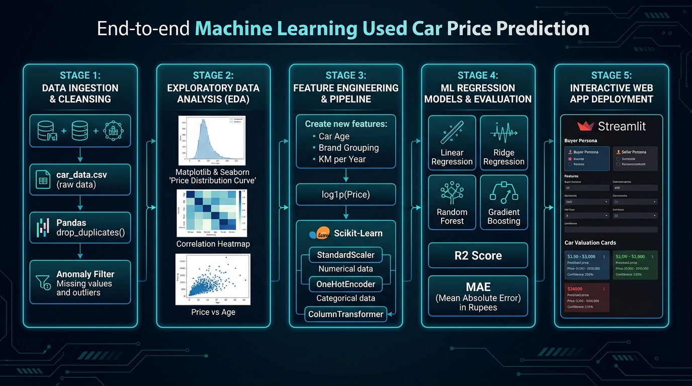
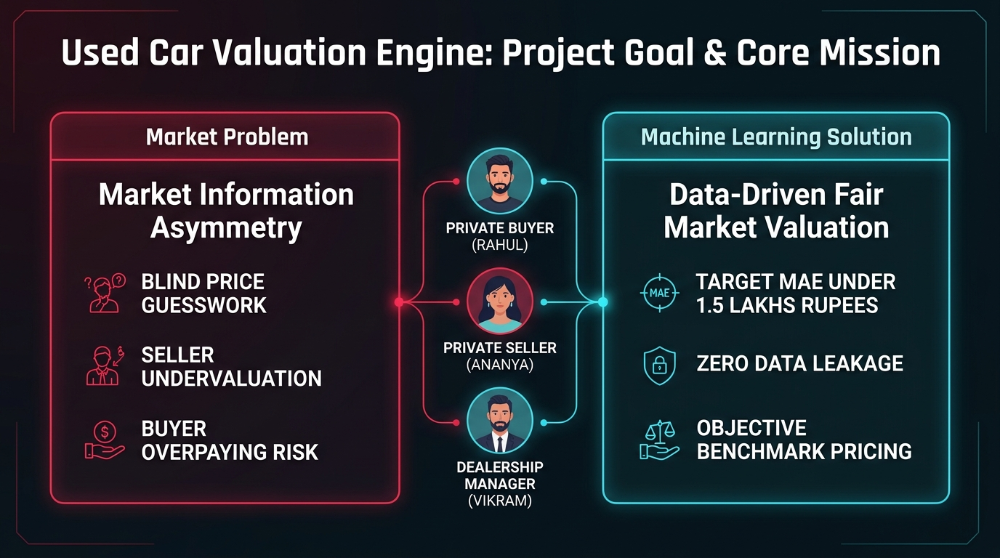
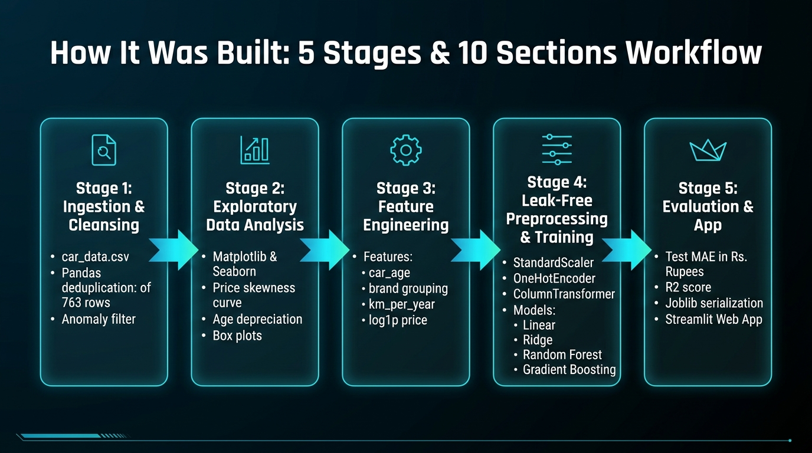
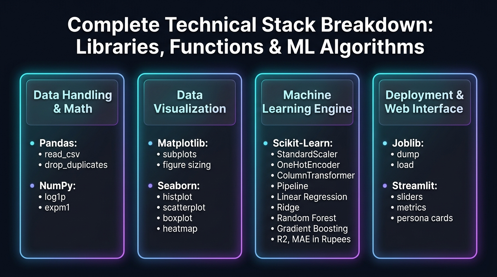

# Used Car Price Prediction & Regression Valuation Engine

[](https://www.python.org/downloads/)
[](https://opensource.org/licenses/MIT)
[](https://pandas.pydata.org/)
[]()
[](https://colab.research.google.com/github/adarshgaurav1951/Used-Cars-Regression-Analysis/blob/main/used_car_price.ipynb)
[](http://localhost:8501)
[](http://localhost:8501)

An end-to-end Machine Learning regression project and interactive valuation application developed according to the specifications in [prd.md](prd.md). The system estimates pre-owned car fair market prices in Indian Rupees (₹), analyzes depreciation curves, and provides strategic pricing recommendations for buyers, sellers, and dealership appraisers.

---

## 🗺️ End-to-End Pipeline Architecture



### 🎯 1. Main Goal of this Project



In the used car marketplace, neither buyers nor sellers have complete transparency over fair vehicle value. Price depends heavily on coupled interactions between continuous attributes (vehicle age, odometer mileage, annual usage intensity) and categorical attributes (brand tier, fuel type, transmission mechanism, ownership status). 

The primary objectives of this project are:
1. **Accurate Valuation:** Estimate fair market values in Indian Rupees (₹) with a benchmark Mean Absolute Error (MAE) under ₹1.5 Lakhs and $R^2 \ge 0.65$.
2. **Zero Data Leakage:** Ensure that all imputations, feature standardizations, and one-hot encodings are fitted strictly on training subsets via encapsulated scikit-learn `Pipeline` and `ColumnTransformer` objects.
3. **Transparent Explainability:** Identify the dominant economic depreciation factors and quantify how much specific upgrades (e.g., Automatic transmission vs. Manual) impact vehicle resale.
4. **Actionable Decision Support:** Deploy an interactive, persona-tailored valuation interface for private buyers, individual sellers, and dealership inventory managers.

---

### 🏗️ 2. How the Project Was Built from Start to End

```mermaid
graph LR
    A["1. Data Ingestion<br/>(car_data.csv)"] --> B["2. Data Cleansing<br/>(Drop Duplicates & Anomalies)"]
    B --> C["3. Exploratory Data Analysis<br/>(Distributions & Box Plots)"]
    C --> D["4. Feature Engineering<br/>(car_age, brand, km_per_year, log_price)"]
    D --> E["5. Leak-Free Preprocessing<br/>(StandardScaler & OneHotEncoder)"]
    E --> F["6. Multi-Model Regression<br/>(Linear, Ridge, RF, Gradient Boosting)"]
    F --> G["7. Evaluation & Interpretation<br/>(R2, MAE in Rupees, Feature Importance)"]
    G --> H["8. Serialization & Deployment<br/>(Joblib & Streamlit Web App)"]
```





#### Detailed Breakdown by Stage:

1. **Data Ingestion & Initial Inspection:**
   - **Library:** `pandas`
   - **Functions:** `pd.read_csv("car_data.csv")`, `df.shape`, `df.info()`, `df.describe()`, `df.isnull().sum()`
   - **Goal:** Ingest 4,340 raw used-car listings and audit data hygiene without altering the original CSV file.

2. **Data Cleaning & Anomaly Resolution:**
   - **Library:** `pandas`
   - **Functions:** `df.drop_duplicates()`, boolean masking (`df["km_driven"] >= 100`)
   - **Goal:** Removed 763 duplicate listings (17.6%) that would artificially weight training samples. Filtered an erroneous listing with 1 km recorded on a 2014 car. Preserved genuine high-end luxury listings.

3. **Exploratory Data Analysis (EDA):**
   - **Libraries:** `matplotlib.pyplot`, `seaborn`, `numpy`
   - **Functions:** `sns.histplot()`, `sns.scatterplot()`, `sns.boxplot()`, `sns.heatmap()`, `np.log1p()`
   - **Goal:** Uncovered severe right-skewness in raw selling prices, necessitating log-normal transformation. Revealed steep exponential depreciation over the first 5–7 years, substantial premiums for diesel and automatic transmissions, and monotonic value decline across ownership transitions.

4. **Domain Feature Engineering:**
   - **Libraries:** `pandas`, `numpy`
   - **Functions:** `df.apply()`, string tokenization, `value_counts()`
   - **Features Created:**
     - `car_age = 2020 - year`: Directly models vehicle age relative to the dataset reference year.
     - `brand`: Extracted first word from vehicle name; grouped rare brands (< 25 listings) into `"Other"`.
     - `km_per_year = km_driven / (car_age + 1)`: Quantifies annual vehicle wear rate.
     - `log_price = np.log1p(selling_price)`: Stabilizes regression variance.

5. **Leak-Free Preprocessing Architecture:**
   - **Library:** `scikit-learn`
   - **Modules & Classes:** `train_test_split(random_state=42)`, `StandardScaler()`, `OneHotEncoder(drop='first', handle_unknown='ignore')`, `ColumnTransformer()`
   - **Goal:** Partitioned data into 80% train (2,860 rows) and 20% test (716 rows). Isolated transformers inside a `ColumnTransformer` to guarantee zero test leakage.

6. **Model Training & Benchmarking:**
   - **Library:** `scikit-learn`
   - **Pipelines & Algorithms:** `Pipeline()`, `LinearRegression()`, `Ridge(alpha=1.0)`, `RandomForestRegressor()`, `GradientBoostingRegressor()`
   - **Goal:** Trained candidate models sequentially from unregularized baseline to regularized linear and complex tree ensembles on `(X_train, y_train_log)`.

7. **Evaluation, Inversion & Explainability:**
   - **Library:** `scikit-learn`, `numpy`
   - **Functions:** `np.expm1()`, `r2_score()`, `mean_absolute_error()`, `root_mean_squared_error()`, `KFold()`, `cross_val_score()`
   - **Goal:** Mapped log predictions back to Indian Rupees scale. Ridge Regression demonstrated the highest generalizability with a test $R^2 \approx 0.670$ in Rupees ($0.774$ on log scale) and lowest MAE (₹1.47 Lakhs). Extracted Gradient Boosting feature importances identifying car age and transmission type as dominant price drivers.

8. **Serialization & Web Application:**
   - **Libraries:** `joblib`, `streamlit`
   - **Functions:** `joblib.dump()`, `joblib.load()`, `st.metric()`, `st.tabs()`, `st.image()`
   - **Goal:** Serialized production pipelines and metadata into `models/`. Built a responsive web app with persona-based playbooks and a "what-if" valuation sensitivity simulator.

---

### 🛠️ 3. Complete Technical Stack Breakdown



| Layer | Library Used | Functions & Classes | Purpose & Logic |
|---|---|---|---|
| **Data Handling** | `pandas` | `pd.read_csv`, `df.drop_duplicates()`, `df.isnull().sum()`, `df.apply()` | Tabular ingestion, duplicate removal, brand extraction, summary stats. |
| **Math & Transforms** | `numpy` | `np.log1p()`, `np.expm1()` | Natural log-transform to compress skewed prices; exponentiation back to ₹. |
| **Visualizations** | `matplotlib`, `seaborn` | `plt.subplots()`, `sns.histplot()`, `sns.scatterplot()`, `sns.boxplot()`, `sns.heatmap()`, `sns.barplot()` | Distribution charts, scatter correlations, box plots, heatmap, feature importance plot. |
| **Preprocessing** | `scikit-learn` | `StandardScaler()`, `OneHotEncoder(drop='first')`, `ColumnTransformer()` | Normalizes numerical scales and creates dummy variables without leakage. |
| **Workflow Guard** | `scikit-learn` | `Pipeline()` | Chains preprocessing and model estimation; guarantees test data is never leaked. |
| **Validation** | `scikit-learn` | `train_test_split(random_state=42)`, `KFold()`, `cross_val_score()` | Holdout evaluation (80/20) and 5-fold cross-validation. |
| **Linear ML Models** | `scikit-learn` | `LinearRegression()`, `Ridge(alpha=1.0)` | Unregularized OLS baseline and L2 regularized regression (Top performer: MAE ~₹1.47 Lakhs). |
| **Ensemble ML Models**| `scikit-learn` | `RandomForestRegressor()`, `GradientBoostingRegressor()` | Bagged decision trees and boosted residual trees for non-linear thresholds. |
| **Evaluation Metrics**| `scikit-learn` | `r2_score()`, `mean_absolute_error()`, `root_mean_squared_error()` | Variance explained ($R^2$) and typical absolute price error in ₹ (MAE). |
| **Model Persistence** | `joblib` | `joblib.dump()`, `joblib.load()` | Serializing trained pipelines to disk for real-time web inference. |
| **Web Application** | `streamlit` | `st.set_page_config()`, `st.sidebar`, `st.metric()`, `st.tabs()`, `st.image()` | Interactive UI with real-time prediction and persona-specific strategy cards. |

---


## 🌟 Key Features

1. **Exploratory Data Analysis & Depreciation Modeling:**
   - 10-section top-to-bottom pipeline in [used_car_price.ipynb](used_car_price.ipynb).
   - In-depth analysis of vehicle age, odometer mileage, fuel efficiency, transmission type, and ownership tier.
   - Target log-normalization (`np.log1p`) to eliminate heavy price skew and stabilize regression residuals.

2. **Leak-Free Preprocessing Architecture:**
   - Strict separation between training (80%) and test (20%) data.
   - Encapsulated scikit-learn `ColumnTransformer` with `StandardScaler` for numeric variables and `OneHotEncoder(drop='first', handle_unknown='ignore')` for categoricals.
   - Pipeline fitting performed strictly on training data.

3. **Multi-Model Benchmark:**
   - **Linear Regression & Ridge Regression:** Benchmark models achieving test $R^2 \approx 0.670$ in Rupees ($R^2 \approx 0.775$ on log scale) and lowest MAE ($\approx ₹1.47$ Lakhs).
   - **Gradient Boosting Regressor & Random Forest:** Capturing non-linear thresholds and feature importances.

4. **Interactive Valuation Web Application ([app.py](app.py)):**
   - **Persona-Driven Strategies:** Tailored pricing advice for **Rahul (Buyer)**, **Ananya (Seller)**, and **Vikram (Dealership Manager)**.
   - **What-If Sensitivity Simulator:** Real-time calculation of value delta for transmission shifts, mileage increases, and ownership transitions.
   - **Model Transparency:** Displays live PRD benchmark metrics and top feature importance rankings.

---

## 📊 Benchmark Model Performance

| Model | Train $R^2$ (₹) | Test $R^2$ (₹) | Test $R^2$ (Log Scale) | Test MAE (₹) | Test RMSE (₹) |
|---|---|---|---|---|---|
| **Ridge Regression (Recommended)** | 0.6822 | **0.6696** | **0.7740** | **₹1,47,720** | ₹3,26,233 |
| **Linear Regression (Baseline)** | 0.7035 | **0.6698** | **0.7748** | **₹1,47,370** | ₹3,26,119 |
| **Gradient Boosting** | 0.6885 | 0.6524 | 0.7730 | ₹1,48,042 | ₹3,34,620 |
| **Random Forest** | 0.8986 | 0.6151 | 0.7558 | ₹1,52,322 | ₹3,52,123 |

*Evaluated on 716 unseen test listings with predictions mapped back to Indian Rupees.*

---

## 📁 Repository Structure

```
Used Cars Regression Analysis/
├── car_data.csv               # Clean source dataset (CarDekho pre-owned listings)
├── used_car_price.ipynb       # 10-section analysis notebook (unmodified & fully executed)
├── prd.md                     # Complete Product Requirements Document
├── idea.md                    # Project blueprint & roadmap
├── AGENTS.md                  # Agent rules and operational guidelines
├── app.py                     # Streamlit valuation web application
├── README.md                  # Project overview and usage guide
├── models/
│   ├── ridge_pipeline.joblib             # Serialized Ridge regression pipeline
│   ├── gradient_boosting_pipeline.joblib # Serialized Gradient Boosting pipeline
│   └── metadata.json                     # Feature schemas, categories, and metrics
└── venv/                      # Local Python virtual environment
```

---

## 🚀 Quick Start Guide

### 1. Activate Environment
```bash
source venv/bin/activate
```

### 2. Run the Valuation Web Application
```bash
./venv/bin/streamlit run app.py
```
Open **[http://localhost:8501](http://localhost:8501)** in your browser or click [](http://localhost:8501) to use the interactive price estimator.

### 3. View the Notebook
Open [used_car_price.ipynb](used_car_price.ipynb) in Antigravity or VS Code using the `Python (used-cars venv)` kernel to explore the 10 analysis sections, visualizations, and statistical findings.
