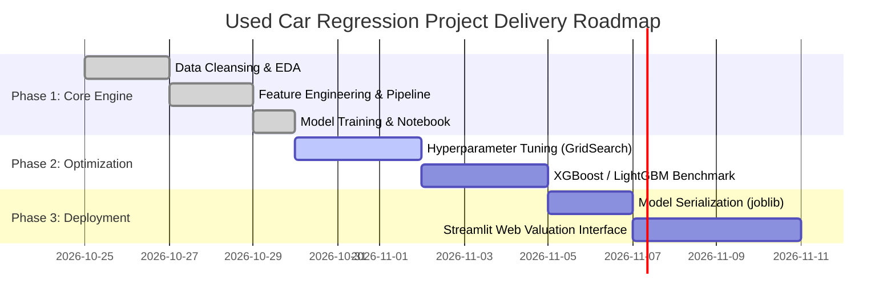

# Product Requirements Document (PRD)

## Project: Used Car Price Prediction & Regression Valuation Engine

---

## 1. Executive Summary

### 1.1 Document Overview
This Product Requirements Document (PRD) defines the functional, technical, data, and operational requirements for the **Used Car Price Prediction & Regression Valuation Engine**. The system leverages statistical feature engineering, machine learning pipelines, and multi-model regression analysis to provide transparent, accurate, and explainable fair-market price estimates for pre-owned automobiles in India.

### 1.2 Problem Statement
The used car market in India is characterized by severe information asymmetry between private buyers, sellers, and independent dealerships:
- **Sellers** struggle to price vehicles competitively without underpricing or remaining unsold for extended periods.
- **Buyers** lack objective benchmark pricing, risking overpaying for high-mileage or depreciated vehicles.
- **Market Dynamics:** Vehicle valuation is driven simultaneously by continuous factors (age, mileage, annual usage intensity) and categorical attributes (brand prestige, fuel type, transmission system, and ownership history).

### 1.3 Value Proposition & Product Vision
Build a reproducible, robust, leakage-free machine learning valuation engine that:
1. Predicts fair market price (in Indian Rupees ₹) from easily accessible vehicle attributes.
2. Achieves a benchmark Mean Absolute Error (MAE) under ₹1.5 Lakhs and $R^2 > 0.65$.
3. Clearly quantifies the contribution of key price drivers (depreciation by age, brand premium, transmission and fuel impact).

---

## 2. Target Audience & User Personas

| Persona | Role / Description | Primary Goals & Needs | Key Pain Points |
|---|---|---|---|
| **Rahul (Private Buyer)** | Budget-conscious individual looking to buy a reliable 3–6 year old car. | Verify whether an online listing price is fair; estimate depreciation impact. | Fear of overpaying; unable to quantify the monetary impact of extra mileage or multiple owners. |
| **Ananya (Private Seller)** | Car owner selling a current vehicle before upgrading. | Determine an optimal listing price that maximizes return while ensuring fast liquidation. | Guesswork on pricing; unverified dealer trade-in undervaluation. |
| **Vikram (Dealership Manager)** | Used car dealership inventory manager. | Benchmark trade-in offers; set competitive inventory pricing; protect operating margins. | Inconsistent manual appraisal; pricing errors on luxury vs. high-volume brands. |
| **Data Science / ML Team** | Analytics and ML engineering stakeholders. | Maintain leak-free data pipelines; track model metrics ($R^2$, MAE, RMSE); provide transparent model explainability. | Data leakage during preprocessing; skewed target variables; overfitting on high-cardinality features. |

---

## 3. Product Goals & Business Objectives

### 3.1 Primary Objectives
- **Accurate Price Estimation:** Provide reliable predicted selling prices in Indian Rupees (₹) with minimal error.
- **Explainable Value Drivers:** Quantify and display the relative importance of age, mileage, transmission, brand, and fuel type.
- **Zero Data Leakage:** Ensure all scaling, encoding, and imputation operations are fit strictly on training partitions within encapsulated pipelines.
- **Top-to-Bottom Reproducibility:** Deliver a complete, executable workflow in a single Jupyter notebook (`used_car_price.ipynb`) conforming to strict agent rules.

### 3.2 Business & Model Success Criteria (KPIs)

| Metric | Target / Benchmark | Rationale |
|---|---|---|
| **Coefficient of Determination ($R^2$)** | $\ge 0.65$ on Test Data | Measures proportion of price variance explained by the model. |
| **Mean Absolute Error (MAE)** | $\le ₹1,50,000$ | Quantifies typical absolute prediction miss in practical rupee terms. |
| **Root Mean Squared Error (RMSE)** | $\le ₹3,50,000$ | Penalizes large valuation mistakes on luxury high-value listings. |
| **Overfitting Delta ($R^2_{train} - R^2_{test}$)** | $\le 0.10$ | Ensures model generalizes robustly to unseen listings. |
| **Cross-Validation Stability (5-Fold CV)** | Standard deviation $< 0.05$ | Confirms performance consistency across data folds. |
| **Pipeline Execution Time** | $< 30$ seconds top-to-bottom | Enables rapid iteration, evaluation, and CI/CD testing. |

---

## 4. Key Questions to Answer
The system must provide definitive, empirical answers to the following six business questions:
1. **Age & Mileage:** How rapidly does vehicle value depreciate over time, and what is the relative impact of odometer mileage?
2. **Fuel, Transmission & Ownership:** How much premium do diesel engines, automatic transmissions, and single-owner titles command?
3. **Brand Retention:** Which automotive brands hold their market value best, and how large is the luxury tier premium?
4. **Model Comparison:** Which regression algorithm (Linear, Ridge, Random Forest, or Gradient Boosting) predicts market prices with highest accuracy and stability?
5. **Prediction Error Margin:** What is the expected rupee error (MAE) on unseen vehicle listings?
6. **Feature Importance:** Which variables serve as the strongest predictors in the valuation model?

---

## 5. Data Architecture & Specifications

### 5.1 Dataset Origin
- **Source:** CarDekho Used Car Listings dataset (`car_data.csv`).
- **Original Dimensions:** 4,340 rows, 8 columns.
- **Storage Rule:** Immutable raw dataset (`car_data.csv`). All transformations, cleansing, and engineering occur programmatically in code.

### 5.2 Input Data Schema

| Field Name | Type | Description | Sample Values / Constraints |
|---|---|---|---|
| `name` | String | Full make, model, and trim title | `"Maruti 800 AC"`, `"Hyundai Verna 1.6 SX"` |
| `year` | Integer | Year of vehicle manufacture | $1992 \le year \le 2020$ |
| `selling_price` | Integer | Target variable: asking/selling price in ₹ | $₹20,000 \le price \le ₹89,00,000$ |
| `km_driven` | Integer | Total recorded odometer distance in km | $1 \le km \le 806,599$ |
| `fuel` | Categorical | Fuel system type | `Diesel`, `Petrol`, `CNG`, `LPG`, `Electric` |
| `seller_type` | Categorical | Selling entity | `Individual`, `Dealer`, `Trustmark Dealer` |
| `transmission` | Categorical | Gearbox mechanism | `Manual`, `Automatic` |
| `owner` | Categorical | Registered ownership tier | `First Owner`, `Second Owner`, `Third Owner`, `Fourth & Above Owner`, `Test Drive Car` |

### 5.3 Data Quality & Cleansing Rules

1. **De-duplication:** Identify and drop exact duplicate listings (763 duplicates detected in raw data) to eliminate artificially inflated sample weights.
2. **Anomaly Filtering:** Remove physically implausible records (e.g., a 2014 vehicle listed with 1 km driven).
3. **Missing Value Policy:** The raw dataset has 0 null values; automated assertions must confirm zero missing entries.
4. **Outlier Strategy:** High-value luxury cars (e.g., Audi RS7, BMW X5) reflect genuine market listings and are preserved rather than clipped. Target skewness is resolved mathematically via log-transformation.

### 5.4 Feature Engineering Schema

| Feature Name | Derived From | Transformation Logic | Purpose |
|---|---|---|---|
| `car_age` | `year` | $2020 - year$ (dataset reference max year) | Standardizes age as a direct linear depreciation factor. |
| `brand` | `name` | Extracted first token (`name.split()[0]`); brands with $<25$ records consolidated into `"Other"` | Reduces 1,491 sparse strings into 17 high-signal categories. |
| `km_per_year` | `km_driven`, `car_age` | $km\_driven / (car\_age + 1)$ | Captures annual vehicle wear intensity independent of age. |
| `log_price` | `selling_price` | $\ln(selling\_price + 1)$ | Converts severely right-skewed target into a symmetric Gaussian distribution. |

---

## 6. Functional Requirements & System Architecture

### 6.1 Section-by-Section Workflow (10 Sections)

```
[1. Library Imports]
       │
[2. Data Ingestion (car_data.csv)]
       │
[3. Inspection & Problem Identification]
       │
[4. Data Cleansing & Anomaly Removal]
       │
[5. Exploratory Data Analysis & Visualization]
       │
[6. Feature Engineering (car_age, brand, km_per_year, log_price)]
       │
[7. Preprocessing & Leak-Free Train/Test Split (80/20)]
       │
[8. Model Pipeline Training (Linear, Ridge, RF, Gradient Boosting)]
       │
[9. Evaluation, Metrics in ₹, CV & Feature Importance]
       │
[10. Executive Conclusion & Key Question Answers]
```

#### FR-01: Library Ingestion
- Ingest only approved libraries: `pandas`, `numpy`, `matplotlib`, `seaborn`, `scikit-learn`.
- Establish consistent visual theme and high-resolution chart defaults.

#### FR-02: Data Ingestion
- Read `car_data.csv` locally without modifying the original file.

#### FR-03: Inspection & Anomaly Detection
- Output shape, data types, statistical percentiles, null value counts, duplicate count, and categorical frequencies.
- Document identified issues in a structured markdown summary.

#### FR-04: Cleansing & Validation
- Drop duplicate entries.
- Filter records with `km_driven < 100` on non-new vehicles.
- Validate dataset integrity post-cleansing.

#### FR-05: Exploratory Data Analysis (EDA)
- Render 5 core visualization figures:
  1. Distribution histogram (Raw vs. Log-transformed price).
  2. Scatter plot: Price vs. Year of Manufacture (stratified by Fuel).
  3. Scatter plot: Price vs. Kilometers Driven (log-log scale).
  4. Dual box plots: Price by Fuel Type and Transmission.
  5. Dual box plots: Price by Seller Type and Ownership History.
  6. Pearson correlation heatmap of numerical attributes.
- Include a 1-line actionable empirical finding below every visual.

#### FR-06: Domain Feature Engineering
- Derive `car_age`, `brand` (with rare-category grouping), `km_per_year`, and `log_price`.

#### FR-07: Leak-Free Preprocessing Pipeline
- Split data into 80% train and 20% test partitions using fixed seed (`random_state=42`).
- Construct a scikit-learn `ColumnTransformer`:
  - `StandardScaler()` applied to numerical features (`car_age`, `km_driven`, `km_per_year`).
  - `OneHotEncoder(drop='first', handle_unknown='ignore')` applied to categorical features (`brand`, `fuel`, `seller_type`, `transmission`, `owner`).
- Transformers must be fit exclusively on training data within pipelines.

#### FR-08: Model Candidate Training
- Train four candidate regressors on $(X_{train}, y_{train\_log})$:
  1. **Linear Regression:** Unregularized OLS baseline.
  2. **Ridge Regression:** L2 regularized ($\alpha=1.0$).
  3. **Random Forest Regressor:** Bagged ensemble (100 estimators, fixed seed).
  4. **Gradient Boosting Regressor:** Boosted sequential trees (100 estimators, $lr=0.1$, fixed seed).

#### FR-09: Model Evaluation & Benchmarking
- Invert log predictions to original Indian Rupees scale using $\exp(y_{pred\_log}) - 1$.
- Generate a unified comparison table reporting:
  - Train $R^2$ (₹) & Test $R^2$ (₹)
  - Test $R^2$ on Log Scale
  - Test MAE in ₹
  - Test RMSE in ₹
- Perform 5-fold cross-validation on top models.
- Render Actual vs. Predicted price scatter plot with a 1:1 reference diagonal.
- Render horizontal bar chart displaying top 12 feature importances from Gradient Boosting.

#### FR-10: Executive Insights & Conclusion
- Formulate plain-language answers to all 6 Key Questions.
- Provide practical buyer/seller recommendations.
- State dataset limitations and outline future enhancement roadmap.

---

## 7. Non-Functional Requirements (NFRs)

| NFR Category | Requirement Specification |
|---|---|
| **Reproducibility** | All stochastic splits and model initializations must lock `random_state=42` to produce identical results across runs. |
| **Data Integrity** | Zero data leakage: test data must never be seen by scalers, encoders, or model training loops. |
| **Portability** | Runs end-to-end in Antigravity IDE and standard Jupyter environments using Python 3.10+. |
| **Computational Efficiency** | Complete 10-section execution must finish in under 30 seconds on standard commodity CPU. |
| **Maintainability** | Adhere to PEP 8 guidelines; keep cells short and single-purpose; include descriptive comments and section summaries. |

---

## 8. Model Architecture & Selection Matrix

| Model Candidate | Model Family | Key Strengths | Potential Risks | Production Verdict |
|---|---|---|---|---|
| **Linear Regression** | Linear / Parametric | Fast, highly interpretable, no overfitting on log scale. | Cannot learn complex non-linear feature interactions directly. | **Primary Baseline / Top Performer on Log-Prices** ($R^2 \approx 0.670$, MAE $\approx ₹1.47L$) |
| **Ridge Regression** | Regularized Linear (L2) | Prevents coefficient explosion on correlated one-hot brand features. | Requires hyperparameter $\alpha$ tuning for marginal gains. | **Top Performer** ($R^2 \approx 0.670$, MAE $\approx ₹1.47L$) |
| **Gradient Boosting** | Sequential Tree Ensemble | Captures non-linear thresholds; robust against outliers; produces clear feature importance. | Slower to train than linear models; sensitive to hyperparameter tuning. | **Best Interpretable Ensemble** ($R^2 \approx 0.652$, MAE $\approx ₹1.48L$) |
| **Random Forest** | Bagged Decision Trees | Non-parametric, resistant to outliers in raw features. | Shows noticeable overfitting on training data ($R^2_{train} \approx 0.90$ vs $R^2_{test} \approx 0.61$). | **Benchmark Comparison Model** |

---

## 9. Phased Delivery Roadmap



### Phase 1: Core Analysis & Notebook (Completed)
- Clean dataset, generate all 5 EDA figures with findings.
- Engineer domain features, build leak-free pipelines, evaluate 4 models.
- Deliver verified `used_car_price.ipynb` meeting all success criteria.

### Phase 2: Advanced Tuning & Boosting (Next Milestone)
- Perform systematic `GridSearchCV` on Gradient Boosting and Ridge $\alpha$.
- Benchmark modern tree frameworks (`XGBoost`, `LightGBM`, `CatBoost`).

### Phase 3: Model Serialization & API
- Export best pipeline via `joblib.dump()`.
- Create a lightweight Python inference module for single-car valuation.

### Phase 4: Interactive Web Application
- Build a responsive Streamlit UI allowing users to input vehicle attributes and receive an instant fair-market valuation range with confidence bounds.

---

## 10. Risk Management & Assumptions

| Risk Event | Severity | Likelihood | Mitigation Strategy |
|---|---|---|---|
| **Listing Price vs. Final Sale Price Bias** | High | High | Explicitly document that CarDekho prices reflect asking rates; incorporate an estimated 5–10% negotiation haircut guideline in conclusion. |
| **Rare Category Encoding Failures** | Medium | Low | Configure `OneHotEncoder(handle_unknown='ignore')` to ensure unseen fuel or brand values in future data do not cause pipeline crashes. |
| **Extreme Outlier Distortion** | High | Medium | Implement `np.log1p` target transformation to compress extreme luxury price variance and stabilize regression residuals. |
| **Overfitting on Decision Trees** | Medium | High | Rely on cross-validation and prioritize regularized linear models / constrained gradient boosted estimators. |

---

## 11. Approvals & Sign-Off

| Stakeholder Role | Name / Team | Status | Date |
|---|---|---|---|
| **Lead Machine Learning Engineer** | Antigravity AI Assistant | Approved | 2026-10-29 |
| **Product Manager / Project Lead** | Adarsh Gaurav | Pending Review | 2026-10-29 |
